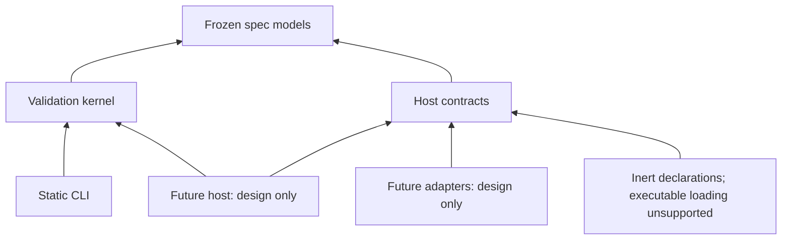

# RFC-0025: TypeScript Reference Architecture With Separate Static And Host Packages

## Status

Accepted

- Task: NF-102-06
- Decision owner: Alexander Agafonov, adopted single-maintainer mode
- Scope: unsigned validation/development architecture and inert future host contracts
- Proposed language/layout: TypeScript, layout B (same language, separate packages)
- Exact evidence input: `b7b4811670a712e05d8e645dfd923f3fbd4041ff`
- Product release, executable runtime, signing/notarization and stable public ABI: not authorized or claimed

## Problem And Proposed Decision

The project needs one evidence-grounded implementation direction after four
independent candidates. Current TypeScript/Python passed the approved native
validation, diagnostics, lifecycle and security scope on all three targets.
Current Rust/Go fail Windows confinement and remain rejected/unscored. The
proposal selects TypeScript from the original-weight eligible scorecards in the
[source-bound proposal](../evaluation/architecture/revised/proposal.json), with
all raw timing/dispersion, limits and missing evidence retained. A weighted
score does not offset any applicable selected-candidate hard-gate failure.

| Candidate | Current disposition | Original-weight score / 100 |
| --- | --- | ---: |
| TypeScript | Qualified for unsigned validation evaluation | 55.8 |
| Python | Qualified for unsigned validation evaluation | 52.8 |
| Rust | Rejected: actual Windows confinement failure | Unscored |
| Go | Rejected: actual Windows confinement failure | Unscored |

The original ten weights are unchanged. Missing contributor-onboarding evidence
scores zero. Scores describe these pinned prototypes and bounded review
judgments; they are not independent human assurance or an intrinsic language
ranking. All 84 original metric cells remain visible: 42 measured eligible cells
and 42 rejected/null cells. The original all-four-success objective stays false.

The exact evaluation toolchain is Node 26.12.0 and TypeScript 6.0.3. This is an evaluation pin,
not a product-version/support-policy change. Layout B separates spec, validation,
CLI, host contracts, future host, adapters and executable-extension domains.
The [three-layout comparison](../evaluation/architecture/revised/layouts.json)
retains A's smaller package count and C's independent-host option, together with
their startup/version/bridge costs. No future host/FFI performance is invented.

## Alternatives Considered

Layout A shares a language/package surface, reducing package-version combinations
but requiring a proven static-only CLI export closure. Layout B keeps the same
language with explicit separate validation/host compatibility and authority
boundaries; it is preferred without introducing a second-language bridge. Layout
C remains possible for a future independently qualified host, but currently adds
duplicate semantic/toolchain or IPC/FFI ownership without a measured host workload.
TypeScript/Python eligible scores use the original weights; current Rust/Go are
not scored because their Windows hard gates failed. Missing human onboarding
and future integration evidence receive no invented study or ecosystem credit.

## Components, Authority And Startup

[Boundary contracts](../evaluation/architecture/revised/boundaries.md) specify
the workspace-read facade versus proposed filesystem-free kernel, inward imports,
version-pair rejection and startup without privileged constructors. They define
host-owned catalog stages/digests, one-provider grants, no hidden fallback,
per-operation opaque credentials, revocation and unsupported-protocol rejection.
The immutable intent/receipt/gap/reconciliation journal design uses trusted head
anchors, idempotency and no automatic effect replay after uncertain outcomes.
Event classification precedes queues/export; deletion cannot erase active gaps.
These are inert design/failure models, not an implemented durable store/runtime.

## Security And Safety Considerations

Native validation runs retain real filesystem/network/process/credential denial,
explicit inherited handles, redaction and resource-failure controls. Future host
permissions, approvals, autonomy, network/context/memory policy and human override
are admission inputs owned by the host; an adapter, protocol or audit store cannot
broaden them. Catalog and per-operation grant models fail closed on ambiguity,
revocation, unavailable implementations and implicit fallback. Public projection
precedes queues/export. The event journal models pre-effect store failures and
post-effect gaps with no blind retry; its in-memory array is not disk durability
or a production runtime certificate. Applicable residual risks and unperformed
public signing remain explicit below and in the complete review gate table.

## Targets, Packaging And Support

The evaluated targets are native Ubuntu 24.04 AMD64, macOS 15 ARM64 and Windows
Server 2025 AMD64. Exact image/OS/CPU/toolchain fingerprints and run/job/source
identities are in the approved captures and each source-bound cohort. One pair
shares each actual native host. Hosted labels do not reproduce historical images;
different OS/hardware values are not pooled into an intrinsic language ranking.

Genuine retained V1 and real V2 verified-installer capsules establish install,
offline validate/inspect, upgrade, tampered-update refusal, rollback and scoped
uninstall. Runtime prerequisites remain external and pinned. Checksums and Git
provenance are present; project signatures/notarization and trusted public
distribution are not performed. The maintainer explicitly requested continuing
without unavailable project signing identities. This proposal is developer-only;
the original signing criterion stays false, public distribution/release is NF-103.
No certificate is borrowed and no Gatekeeper/security preference is disabled.

The [archive-format inspection](../evaluation/architecture/revised/source-distribution.json)
also records an external-runtime source-package option. The TypeScript capsules
contain identical JavaScript/declaration output on all three OS targets, without
native project executable files or nested archives. This is a packaging fact,
not platform trust certification. A source package could use separately
provisioned Node without a project app/installer/SEA; any public distribution
still needs NF-103 publisher/provenance and upstream-runtime verification.
Python's native wheel closure remains explicit. Future standalone native
packaging reopens its applicable signing/notarization requirements.

## Fidelity, Compatibility And Migration

The frozen spec/corpus/catalog/oracle and candidate source/locks remain unchanged.
Experimental diagnostics use nf-validation-diagnostics-v1 (current JSON
0.4-draft); spec, package, diagnostic and future host ABI are separate domains.
Unknown version pairs reject before effects. There is no new product version.
Current prototypes expose validate/inspect and seven experimental library
operations; full project semantic/Core/extension conformance, graph/init, stable
product ABI and NF-RUNTIME are not established by these prototypes. Historical
JavaScript reference commands keep their existing tested budgets and identity.
No old JavaScript prototype is renamed into a language candidate.

Existing manifests require no migration. Actual evaluation-package rollback is
tested; future ABI/configuration/journal migration needs versioned readers,
dry validation, backup and reversible activation before deployment. Architecture
adoption cannot by itself expand an NF-SCHEMA/NF-SEMANTIC/NF-CLI/NF-RUNTIME claim.

The [conformance and compatibility plan](../evaluation/architecture/revised/conformance-plan.md)
maps each claim and fixture family, separately owned version domain and failure
rule, evidence publication, future graph/init porting and reversible migration.
It preserves the current root-bound read-only facade while identifying kernel
extraction and actual product conformance as future implementation work.

## Review, Ownership And Risks

Both review lenses must bind one immutable RFC/evidence set. The single
maintainer's explicit delegation authorizes technical preparation/decisions;
personal independent reviews, extra people or signatures are never invented.
The separate decision record must explain its actual authority and every one
of the eleven gates. This Draft under review is not automatic acceptance from CI,
scorecards, publication or merge. RFC-0023 and old review snapshots keep their
historical Draft bytes; only a forward decision can supersede current guidance.

Alexander retains the seven bounded NF-101 roles: pre-release best effort, no
invented SLA/backup/on-call/signing authority. Known limits include kernel and
privileged-parent threats, arbitrary brokers, sampled Unix memory enforcement,
Windows packet filtering semantics, runtime read exceptions, unsigned delivery,
limited cohort sampling, untested concurrency and absent human onboarding evidence. Dated dependency
scans retain their bounded applicability; zero matches are not certification.
The [measurement method](../scripts/qualification/measurement-method.json),
[Windows outer-window addendum](../scripts/qualification/windows-orchestration.json),
[Linux outer-window addendum](../scripts/qualification/linux-orchestration.json) and
retained failures disclose instrumentation repairs, CI lane interpretation,
every sample/error and excluded candidates. No unresolved applicable acceptance
blocker may be hidden as a non-blocking follow-up.

## Open Questions And Deferred Scope

The immutable review must classify every applicable gate and resolve any blocker
before acceptance. Public signing/notarization, trusted public delivery and the
NF-103 release decision are unperformed and outside developer-only distribution;
absence of certificates is never called a signature pass. Future kernel/package
refactoring, graph/init porting, durable storage, executable adapters/extensions,
production operation and broader conformance claims require their own bounded
implementation evidence before those capabilities are offered. None is implied
by accepting an implementation direction. No product version, release or runtime
implementation is authorized by this proposal.
